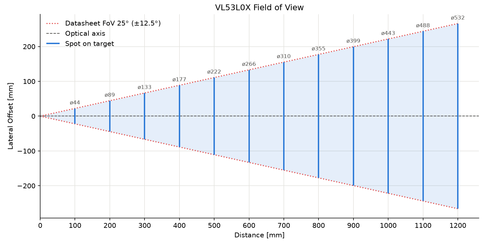

# VL53L0X

Measurement projects with the VL53L0X Time-of-Flight sensor.

## Contents

- [Projects](#projects)
- [Hardware](#hardware)
- [Field of View](#field-of-view)
- [Software](#software)
- [Getting Started](#getting-started)
- [Repository Structure](#repository-structure)
- [License](#license)

## Projects

| Project                             | Purpose                                         |
|-------------------------------------|-------------------------------------------------|
| [calibration](projects/calibration) | Offset definition of the sensor                 |
| [accuracy](projects/accuracy)       | Accuracy determination at stepped target distances |
| [filter](projects/filter)           | Noise reduction using a median filter           |

## Hardware

| Component    | Connection                             |
|--------------|----------------------------------------|
| Board        | ESP32-S3                               |
| VL53L0X      | SDA → GPIO 8, SCL → GPIO 9, VCC → 3.3 V, GND → GND|

Note: 4.7 kΩ pull-ups on SDA and SCL.

### Field of View

The cone of light grows with the distance: 

$y = 2\cdot z \cdot \tan(12.5°)$

$A_{FoV} = \pi \cdot \left(\frac{y}{2}\right)^2$



## Software

- ESP-IDF 5.3
- Python 3, matplotlib
- Official ST VL53L0X API ([STSW-IMG005](https://www.st.com/en/embedded-software/stsw-img005.html))
- C++ wrapper [kerikun11/ESP32_VL53L0X](https://github.com/kerikun11/ESP32_VL53L0X)

## Getting Started

### Build and Flash

```sh
git clone https://github.com/michelfeike-dev/vl53l0x.git
cd vl53l0x/projects/calibration
idf.py set-target esp32s3
idf.py build flash monitor
```

The projects reference the driver from the repository root via
`EXTRA_COMPONENT_DIRS`.

### Usage in Other Projects

The driver can be added as a component via the ESP Component Manager in
`main/idf_component.yml`:

```yaml
dependencies:
  vl53l0x:
    git: https://github.com/michelfeike-dev/vl53l0x.git
    version: v1.3.1
```

Add `vl53l0x` to `REQUIRES` in the component's `CMakeLists.txt`.

## Repository Structure

```
vl53l0x/
├── projects/
│   ├── calibration/       Offset definition
│   ├── accuracy/          Accuracy measurement
│   └── filter/            Median filter
├── doc/                   Figures
├── inc/VL53L0X.h          Driver class
├── api/                   STMicroelectronics VL53L0X API
├── CMakeLists.txt         ESP-IDF component definition
├── idf_component.yml      Component manager manifest
└── CHANGELOG.md
```

## License

MIT, see [LICENSE](LICENSE).