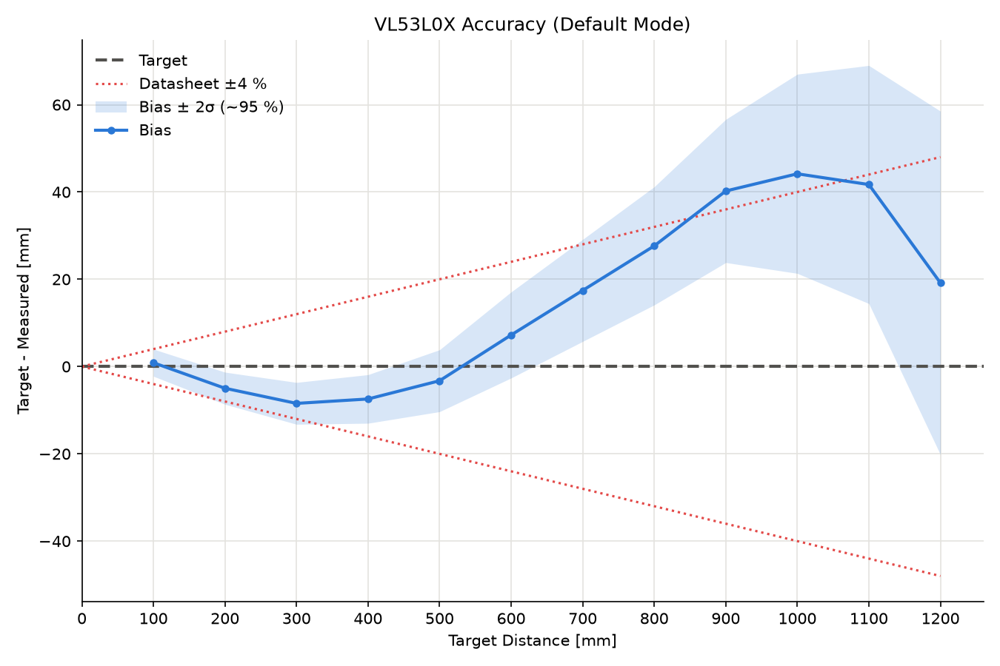
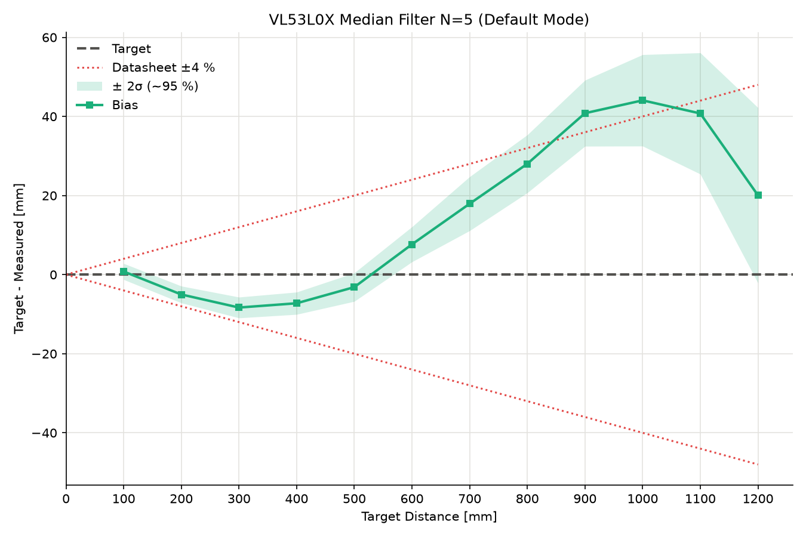

# Accuracy

Sensor accuracy at stepped target distances: bias, standard deviation and
datasheet limit.

## Hardware

| Component    | Connection                             |
|--------------|----------------------------------------|
| Board        | ESP32-S3                               |
| VL53L0X      | SDA → GPIO 8<br>SCL → GPIO 9<br>VCC → 3.3 V<br>GND → GND|
| Start Pin    | GPIO 14                                |
| [Target](../../README.md#field-of-view)      | White                                  |

Note: 

$A_{Target} > A_{FoV}$ 

## Software

- ESP-IDF 5.3
- Python 3, matplotlib
- Official ST VL53L0X API [STSW-IMG005](https://www.st.com/en/embedded-software/stsw-img005.html)
- C++ wrapper [kerikun11/ESP32_VL53L0X](https://github.com/kerikun11/ESP32_VL53L0X)

## Getting Started

### Configuration

| Constant           | Default | Meaning                                      |
|--------------------|---------|----------------------------------------------|
| `OFFSET_MM`        | 28      | Sensor offset [mm]                           |
| `TIMING_BUDGET_US` | 33000   | default mode = 33000us<br> high accuracy mode = 200000us      |
| `DIST_MIN`         | 100     | Target distance minimum [mm]                  |
| `DIST_MAX`         | 1200    | Target distance maximum [mm]                   |
| `DIST_STEP`        | 100     | Delta distance [mm]                                   |
| `NUM_MEASUREMENTS` | 100     | Readings per distance                        |
| `START_PIN`        | 14      | Input         |

### Build and Flash

```sh
cd projects/accuracy
idf.py set-target esp32s3
idf.py build flash monitor
```

### Measurement

1. Place the target at `DIST_MIN`.
2. Negative edge at `START_PIN`.
3. Move the target by `DIST_STEP`, up to `DIST_MAX`
4. Save the monitor output as `data/s1.log`.

## Evaluation

```sh
python3 -m venv .venv && source .venv/bin/activate
pip install matplotlib
python3 eval/evaluate.py data/s1.log -c data/s1.csv -o data/s1.png -m default
```

| Parameter        | Required | Description                                                    |
|------------------|----------|----------------------------------------------------------------|
| `log`            | no       | Input file of the measurement            |
| `-c`, `--csv`    | yes      | Output CSV file                                       |
| `-o`, `--output` | no       | Save accuracy and field of view |
| `-m`, `--mode`   | no       | `default` (±4 %)<br>`high-accuracy` (±3 %)<br>matching `TIMING_BUDGET_US`<br>default `default` |
| `--spec`         | no       | Override the datasheet accuracy [%]                            |
| `--fov`          | no       | Full field of view [°]<br>default 25                             |

**Target distance**: $z$ 

**Measurements**: $x_1 \dots x_n$:

**Bias**:

$$b = \frac{1}{n}\sum_{i=1}^{n}(z - x_i) = z - \bar{x}$$

**Standard deviation**:

$$\sigma = \sqrt{\frac{1}{n-1}\sum_{i=1}^{n}(x_i - \bar{x})^2}$$

**RMSE**:

$$\mathrm{RMSE} = \sqrt{\frac{1}{n}\sum_{i=1}^{n}(z - x_i)^2} \approx \sqrt{b^2 + \sigma^2}$$

```
 Target   n     Mean    Bias    Std   RMSE        95% range   Spec ±3%  OK
    100 100    100.2    -0.2    1.2    1.2     -2.5 .. +2.1       ±3.0 yes
    200 100    206.2    -6.2    0.8    6.3     -7.9 .. -4.5       ±6.0  no
```

## Improvements

### Median-Filter

A sliding median over $N$ readings reduces $\sigma$: 

$$\tilde{x}_k = \mathrm{median}(x_{k-N+1}, \dots, x_k)$$

The median follows a change of the distance with a delay of $\frac{N-1}{2} \cdot T$:

**Timing**: $T \approx$ `TIMING_BUDGET_US`

| Timing budget | Delay $N = 3$     | Delay $N = 5$ |
|---------------|---------|---------------|
| 33 ms         | ≈ 33 ms | ≈ 66 ms       |
| 200 ms        | ≈ 200 ms | ≈ 400 ms     |

#### Evaluation
```sh
python3 eval/filter.py data/s1.log -n 5 -c data/s1_med5.csv -p data/s1_med5.png -m default
```

| Parameter        | Required | Description                                  |
|------------------|----------|----------------------------------------------|
| `log`            | no       | Input file of the measurement                |
| `-n`, `--window` | yes      | Window $N$, odd                              |
| `-c`, `--csv`    | yes      | Output CSV file                              |
| `-p`, `--plot`   | no       | Save the plot                                |
| `-o`, `--output` | no       | Save the filtered log                        |
| `-m`, `--mode`   | no       | `default` (±4 %)<br>`high-accuracy` (±3 %)<br>default `default` |
| `--spec`         | no       | Override the datasheet accuracy [%]          |

Raw readings (left) and median filter $N = 5$ (right), `data/s1.log`:

 

The $2\sigma$ band becomes narrower, the bias stays the same.
