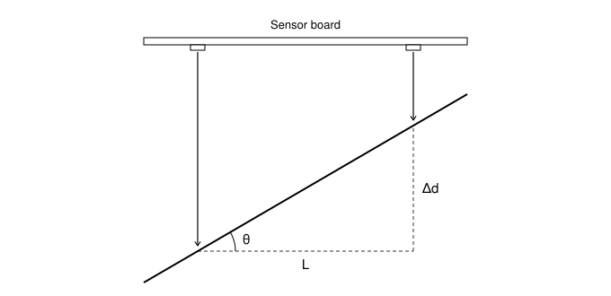
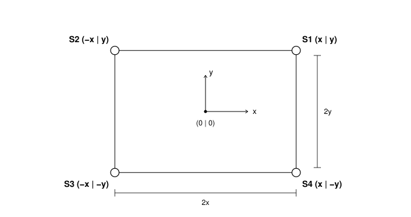

# Level  

Coefficient and angle definition of a plane $ax + by + c = d$.

<p align="center"></p>

The sensor setup:

<p align="center"></p>

```math
S_1 = (x, y), S_2 = (-x, y), S_3 = (-x, -y), S_4 = (x, -y).
```

The sensor $S_i$ equation at position $(x_i, y_i)$: 

```math
a\,x_i + b\,y_i + c = d_i
```

$S_1$ - $S_4$:

```math
\begin{aligned}
\phantom{-}x_1\,a + y_1\,b + c &= d_1 \\
-x_2\,a + y_2\,b + c &= d_2 \\
-x_3\,a - y_3\,b + c &= d_3 \\
\phantom{-}x_4\,a - y_4\,b + c &= d_4
\end{aligned}
```

As matrix: 

```math
A\,\vec p = \vec d
```

with

```math
A = \begin{pmatrix} x_1 & y_1 & 1 \\ -x_2 & y_2 & 1 \\ -x_3 & -y_3 & 1 \\ x_4 & -y_4 & 1 \end{pmatrix}, \quad
\vec p = \begin{pmatrix} a \\ b \\ c \end{pmatrix}, \quad
\vec d = \begin{pmatrix} d_1 \\ d_2 \\ d_3 \\ d_4 \end{pmatrix}
```

System is overdetermined. The least-squares solution minimizes $\lVert A\,\vec p - \vec d \rVert^2$. 

Normal equations:

```math
A^T A\,\vec p = A^T \vec d
```

```math
A^T A = \begin{pmatrix}
\sum x_i^2 & \sum x_i y_i & \sum x_i \\
\sum x_i y_i & \sum y_i^2 & \sum y_i \\
\sum x_i & \sum y_i & 4
\end{pmatrix}, \qquad
A^T \vec d = \begin{pmatrix} \sum x_i d_i \\ \sum y_i d_i \\ \sum d_i \end{pmatrix}
```
Symmetrical sensor setup:

```math
(x_i = \pm x, y_i = \pm y)
```

```math
\sum x_i = \sum y_i = \sum x_i y_i = 0, \qquad
\sum x_i^2 = 4x^2, \qquad
\sum y_i^2 = 4y^2
```

So $A^T A$ is diagonal:

```math
A^T A = \begin{pmatrix} 4x^2 & 0 & 0 \\ 0 & 4y^2 & 0 \\ 0 & 0 & 4 \end{pmatrix}, \qquad
A^T \vec d = \begin{pmatrix} x\,\big((d_1 + d_4) - (d_2 + d_3)\big) \\ y\,\big((d_1 + d_2) - (d_3 + d_4)\big) \\ d_1 + d_2 + d_3 + d_4 \end{pmatrix}
```

Definition $a, b$ and $c$:

```math
a = \frac{(d_1 + d_4) - (d_2 + d_3)}{4\,x}, \qquad
b = \frac{(d_1 + d_2) - (d_3 + d_4)}{4\,y}, \qquad
c = \frac{d_1 + d_2 + d_3 + d_4}{4}
```

Definition of $\theta$:

```math
\tan\theta = \frac{\Delta d}{L} \qquad\Rightarrow\qquad \theta = \arctan\left(\frac{\Delta d}{L}\right)
```

```math
\theta_x = \arctan\left(a\right) \qquad;\qquad \theta_y = \arctan\left(b\right)
```

Setzt man a, b und c wieder ein, bleibt pro Sensor ein kleiner Rest:

$$r_i = d_i - \left( a\,x_i + b\,y_i + c \right)$$

Bei vier Sensoren im Rechteck haben die Reste immer dasselbe Muster: Diagonal gegenüberliegende Sensoren haben dasselbe Vorzeichen.

$$\vec r = r \begin{pmatrix} 1 \\ -1 \\ 1 \\ -1 \end{pmatrix}, \qquad r = \frac{d_1 - d_2 + d_3 - d_4}{4}$$

Das ist der Teil der Messung, den keine Ebene erklären kann, eine Verwindung der Fläche. Ist die Fläche wirklich eben und r trotzdem groß, misst mindestens ein Sensor falsch, zum Beispiel wegen eines nicht kalibrierten Offsets.

9. Genauigkeit

Hat jede Messung einen zufälligen Fehler $\sigma_d$, dann gilt für die Steigungen:

$$\sigma_a = \frac{\sigma_d}{\sqrt{\sum x_i^2}} = \frac{\sigma_d}{60\ \text{mm}}, \qquad \sigma_b = \frac{\sigma_d}{\sqrt{\sum y_i^2}} = \frac{\sigma_d}{40{,}5\ \text{mm}}$$


## Hardware

| Component    | Connection                             |
|--------------|----------------------------------------|
| Board        | ESP32-S3                               |
| VL53L0X      | SDA → GPIO 8<br>SCL → GPIO 9<br>VCC → 3.3 V<br>GND → GND|

## Software

- ESP-IDF 5.3

## Getting Started

### Configuration

| Constant         | Default | Meaning                                    |
|------------------|---------|--------------------------------------------|
| `OFFSET_MM`      | 0       | Offset from [calibration](../calibration)  |

### Build and Flash

```sh
cd projects/level
idf.py set-target esp32s3
idf.py build flash monitor
```

### Output

```text
I (1234) level: 512 [mm]
```


### Example
In this setup $x = 30$ mm and $y = 20{,}25$ mm.

Sensor positions:

```math
S_1 = (30|20{,}25), \quad S_2 = (-30|20{,}25), \quad S_3 = (-30|-20{,}25), \quad S_4 = (30|-20{,}25)
```

```math
A = \begin{pmatrix} 30 & 20{,}25 & 1 \\ -30 & 20{,}25 & 1 \\ -30 & -20{,}25 & 1 \\ 30 & -20{,}25 & 1 \end{pmatrix}, \qquad
A^T A = \begin{pmatrix} 3600 & 0 & 0 \\ 0 & 1640{,}25 & 0 \\ 0 & 0 & 4 \end{pmatrix}
```

with $4x^2 = 4 \cdot 30^2 = 3600$ and $4y^2 = 4 \cdot 20{,}25^2 = 1640{,}25$.

```math
a = \frac{(d_1 + d_4) - (d_2 + d_3)}{120}, \qquad
b = \frac{(d_1 + d_2) - (d_3 + d_4)}{81}, \qquad
c = \frac{d_1 + d_2 + d_3 + d_4}{4}
```

